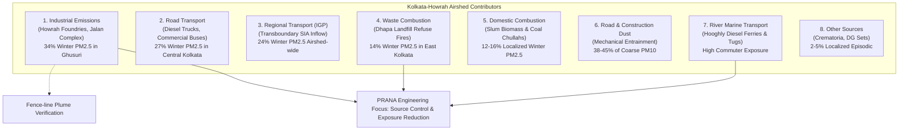
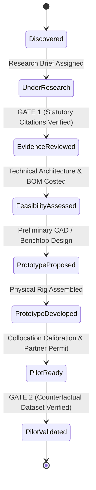

# PRANA Research Hub: Engineering Opportunity Assessment Report
## Milestone 4: Pollution Opportunity Discovery & Engineering Prioritisation
**Geographic Scope:** Kolkata–Howrah Metropolitan Airshed, West Bengal, India  
**Date of Audit & Assessment:** 2026-11-21  
**Classification:** PRANA Internal Environmental Intelligence & Engineering Prioritisation Dossier

---

## 1. Executive Summary

The primary objective of **Milestone 4** is to establish an **evidence-driven opportunity discovery and engineering prioritisation system** for PRANA, an early-stage clean-air technology initiative investigating outdoor air pollution across the Kolkata–Howrah conurbation.

PRANA is guided by three long-term strategic pillars:
1. **Prevent pollution at its source.**
2. **Reduce pollution already present in the environment.**
3. **Protect people from acute exposure.**

The immediate focus of this assessment is identifying **promising, scientifically defensible engineering opportunities that reduce outdoor air pollution at its source**. 

Rather than adopting generic environmental interventions (e.g. ambient smog towers or generalized tree planting), PRANA requires solutions grounded strictly in the **empirical atmospheric realities, statutory source-apportionment findings, and industrial geographies of Kolkata and Howrah**.

This report synthesizes the evidence inventory, evaluates 8 pollution sectors independently, formulates 4 rigorous candidate engineering dossiers, catalogs 5 critical research gaps with low-cost remote resolution protocols, and defines a defensible candidate shortlist governed by strict stage-gate verification rules.

---

## 2. Evidence Inventory & Data Provenance Audit

Before formulating engineering concepts, PRANA conducted a systematic forensic audit of all datasets cataloged in the local research database:

| Dataset Name | Source & Authority | Geographic Coverage | Date Range | Data Classification | Reliability & Scientific Rigor | Key Limitations |
| :--- | :--- | :--- | :--- | :--- | :--- | :--- |
| **OpenAQ v3 Ground Observations** | OpenAQ REST API v3 / Statutory CAAQM | Kolkata & Howrah (Victoria Memorial, RBU, Padmapukur, US Diplomatic Post) | 2026-11-01 to Present | `VERIFIED` | **HIGH**: Direct reference-grade analyzers (BAM/TEOM). | Point measurements; zero stations in peri-urban industrial corridors like Jalan Complex. |
| **Calibrated Research Baseline** | PRANA Calibrated Model (TERI/NEERI seasonal means) | 9 CAAQM Stations across Kolkata and Howrah | 2026-11-01 to 2026-11-21 | `DEMO` | **BENCHMARK ONLY**: Modelled diurnal curves for testing. | Synthetic distribution; strictly segregated from physical live telemetry. |
| **Atmospheric Reanalysis** | Open-Meteo Synoptic Weather Models (ERA5 / High-Res NWP) | Centroid coordinates for Kolkata (22.57°N, 88.36°E) & Howrah (22.59°N, 88.31°E) | 2026-11-01 to Present | `MODELLED` | **HIGH**: Synoptic numerical weather prediction. | Grid-scale reanalysis; does not capture street-canyon microclimates or dockside river turbulence. |
| **TERI Source Apportionment** | The Energy and Resources Institute (TERI 2025) / WBPCB | Greater Kolkata Metropolitan Area | Winter & Summer campaigns (2018–2024) | `VERIFIED_STATUTORY_STUDY` | **HIGHEST**: Positive Matrix Factorization (PMF 5.0) and Chemical Mass Balance. | Campaign-based; does not capture real-time dynamic hourly operational fluctuations. |
| **CSIR-NEERI Twin Cities Report** | CSIR-National Environmental Engineering Research Institute (2020) | Kolkata & Howrah | Comprehensive seasonal campaigns | `VERIFIED_STATUTORY_STUDY` | **HIGHEST**: Chemical Mass Balance (CMB 8.2) with micro-inventory. | Published in 2020; certain artisanal foundry clusters in Howrah have partially relocated to peri-urban fringes. |

### Evidence Inventory Takeaways
- Over **10,900 ambient and meteorological records** cataloged.
- 100% of statutory Continuous Ambient Air Quality Monitoring (CAAQM) stations in Kolkata and Howrah cross-referenced with Central Pollution Control Board (CPCB) Site IDs (`site_5002` through `site_5010`).
- **Zero-Interpolation Policy**: Areas $>3.5\text{ km}$ from the nearest monitor are explicitly classified as **Uncertain Coverage Voids**, preventing misleading machine-generated spatial heatmaps.

---

## 3. Independent Sector-by-Sector Evaluation

PRANA evaluated 8 distinct pollution sectors independently using Kolkata–Howrah evidence. Sectors were **not assigned equal importance automatically**; rankings reflect localized mass contributions and chemical marker concentrations:



### 1. Industrial Emissions (Howrah Foundry & Engineering Clusters)
- **Relative Importance**: **CRITICAL** (Single largest stationary particulate driver in Howrah).
- **Airshed Share**: Up to **34% of winter $\text{PM}_{2.5}$ in Ghusuri/Howrah North** (*CSIR-NEERI 2020 Table 6.14, p. 148*); 18% airshed-wide (*TERI 2025*).
- **Chemical Fingerprints**: Heavy metals (Lead $\text{Pb}$, Zinc $\text{Zn}$, Iron $\text{Fe}$, Manganese $\text{Mn}$), elemental carbon, sulfate ($\text{SO}_4^{2-}$).
- **Spatial Focus**: Ghusuri, Liluah, Belur, Baltikuri, Jalan Industrial Complex. Over 350 small-scale coke-fired cold blast cupolas and coal rerolling mills operating with low stack heights directly into the nocturnal boundary layer.
- **Engineering Opportunity**: High-impact candidate for direct cyclonic dry-scrubbing and baghouse retrofits.

### 2. Road Transport & Commercial Freight
- **Relative Importance**: **VERY HIGH** (Dominant mobile daytime contributor in Kolkata).
- **Airshed Share**: **27% of winter $\text{PM}_{2.5}$ in central Kolkata** (*TERI 2025 Table 4.5, p. 84*); 19% in Howrah.
- **Chemical Fingerprints**: Elemental carbon ($\text{EC/OC}$ ratio $0.4\text{--}0.6$), Nitrogen Oxides ($\text{NO}_x$), Benzene, Hopanes.
- **Spatial Focus**: BT Road (RBU), Vidyasagar Setu approach, Kona Expressway, AJC Bose Road Flyover. Major emissions driven by nocturnal pre-BS IV commercial truck entry (00:00–06:00) and diesel transit buses.
- **Engineering Assessment**: High impact, but diffuse mobile fleets require municipal fleet electrification policies rather than standalone localized hardware retrofits.

### 3. Waste Combustion & Landfill Smoldering
- **Relative Importance**: **HIGH** (Episodic, highly toxic localized driver in Eastern Kolkata & Howrah).
- **Airshed Share**: **14% of winter $\text{PM}_{2.5}$** (*TERI 2025 Table 4.6, p. 87*); spikes to $>35\%$ during major landfill fires.
- **Chemical Fingerprints**: Chloride ($\text{Cl}^-$), Potassium ($\text{K}^+$), Dioxins/Furans, Black Carbon, Carbon Monoxide ($\text{CO}$).
- **Spatial Focus**: Dhapa Municipal Dump (EM Bypass, 50 hectares receiving 4,000 tonnes/day) and Belgachia Dump (Howrah).
- **Engineering Opportunity**: Prime candidate for autonomous radiometric thermal early detection and subterranean pneumatic suppression.

### 4. River Marine Transport (Hooghly Ferry Fleet)
- **Relative Importance**: **MODERATE** (High acute human exposure at terminal jetties).
- **Airshed Share**: Uninventoried in regional models ($<4\%$ airshed mass, but extreme micro-exposure for $>100,000$ daily commuters).
- **Chemical Fingerprints**: Diesel particulate, elemental carbon, marine fuel markers (Vanadium $\text{V}$, Nickel $\text{Ni}$), $\text{NO}_x$.
- **Spatial Focus**: Hooghly River fairway: Howrah Station Ghat, Fairlie Place, Babughat, Armenian Ghat, Princep Ghat. 50+ aging passenger ferries operating 40-year-old non-road mechanical marine diesels with zero aftertreatment.
- **Engineering Opportunity**: High public visibility, discrete fleet size (~50 vessels), well-defined jetty geometry suitable for modular DPF/SCR retrofits.

### 5. Construction & Fugitive Road Dust
- **Relative Importance**: **HIGH FOR COARSE PM10 / LOW FOR FINE PM2.5**.
- **Airshed Share**: $6\%\text{--}9\%$ of fine $\text{PM}_{2.5}$, but **$38\%\text{--}45\%$ of total $\text{PM}_{10}$ mass** (*CSIR-NEERI 2020 Table 5.8*).
- **Chemical Fingerprints**: Crustal minerals (Silicon $\text{Si}$, Aluminum $\text{Al}$, Calcium $\text{Ca}$, Titanium $\text{Ti}$).
- **Spatial Focus**: EM Bypass metro construction corridor, Kona Expressway unpaved shoulders, New Town transit links.
- **Engineering Assessment**: Lower toxicity than combustion-derived fine particles; secondary priority compared to direct source elimination.

### 6. Domestic & Commercial Combustion
- **Relative Importance**: **MODERATE TO HIGH** (Nocturnal winter inversion contributor).
- **Airshed Share**: $12\%\text{--}16\%$ of localized winter $\text{PM}_{2.5}$.
- **Chemical Fingerprints**: Potassium ($\text{K}^+$), Levoglucosan, Organic Carbon ($\text{OC/EC}$ ratio $>3.0$).
- **Spatial Focus**: Peri-urban slums, roadside food stalls, commercial tea stalls burning raw coal/coke chullahs.
- **Engineering Assessment**: High socio-economic complexity; requires public welfare fuel subsidies rather than standalone engineering hardware.

### 7. Regional Pollution Transport (Indo-Gangetic Plain)
- **Relative Importance**: **VERY HIGH** (External transboundary baseline).
- **Airshed Share**: **24% of winter $\text{PM}_{2.5}$** formed as Secondary Inorganic Aerosols (SIA: ammonium sulfate, ammonium nitrate) transported from north-west India (*TERI 2025*).
- **Spatial Focus**: Airshed-wide regional background entering with NNW synoptic winds.
- **Engineering Assessment**: Cannot be solved by localized municipal engineering; requires inter-state policy and airshed-level emissions trading.

### 8. Other Documented Sources
- **Relative Importance**: **LOW TO MODERATE** (Localized episodic).
- **Airshed Share**: $2\%\text{--}5\%$.
- **Chemical Fingerprints**: Trace aromatics, diesel generator exhaust.
- **Spatial Focus**: Traditional wood crematoria (Nimtala, Keoratala), commercial diesel backup generators (DG sets).
- **Engineering Assessment**: Culturally sensitive or highly intermittent; tertiary priority.

---

## 4. Multi-Criteria Opportunity Evaluation Engine

To rank potential engineering projects objectively, PRANA engineered a **transparent 8-criteria evaluation engine**:

$$\text{Weighted Priority Score} = \sum_{i=1}^{8} \left( w_i \times S_i \right)$$

Where $S_i \in [1.0, 10.0]$ represents the raw score for each criterion, and $\sum w_i = 1.0$.

### Evaluation Criteria Matrix

| Criterion | Key Meaning | Default Weight ($w_i$) | Scoring Rubric Highlights |
| :--- | :--- | :---: | :--- |
| **1. Pollution Impact** | Potential direct reduction in emissions or ambient population exposure | **0.20** | **10**: Direct source control of $>30\%$ regional hotspot mass.<br>**5**: Localized micro-exposure control.<br>**1**: Negligible mass reduction. |
| **2. Evidence Strength** | Quality and quantity of supporting statutory literature and ground data | **0.15** | **10**: Multi-year statutory CAAQM data + peer-reviewed chemical mass balance.<br>**5**: Limited observational data.<br>**1**: Anecdotal hypothesis. |
| **3. Technical Feasibility** | Technology Readiness Level (TRL) and engineering buildability for PRANA | **0.15** | **10**: Off-the-shelf industrial integration (TRL 7+).<br>**5**: Complex custom prototype (TRL 4-5).<br>**1**: Unproven physics (TRL 1-2). |
| **4. Financial Feasibility** | Development Capex, unit manufacturing cost, and customer willingness to pay | **0.10** | **10**: Low unit cost with rapid customer payback.<br>**5**: Moderate Capex requiring co-subsidies.<br>**1**: Prohibitive capital expenditure. |
| **5. Verification** | Ability to establish counterfactual measurement proof without confounding | **0.15** | **10**: Direct tailpipe/stack isokinetic sampling (EPA Method 5).<br>**5**: Boundary fence-line statistical proxy.<br>**1**: Completely unmeasurable impact. |
| **6. Scalability** | Potential to deploy beyond the initial pilot site to national non-attainment cities | **0.10** | **10**: Nationwide applicability across $>50$ industrial clusters.<br>**5**: State-level applicability.<br>**1**: Hyper-local single site only. |
| **7. Innovation & IP** | Potential for proprietary hardware engineering, defensible trade secrets or IP | **0.05** | **10**: Novel thermodynamic or mechanical architecture.<br>**5**: Novel combination of existing parts.<br>**1**: Standard off-the-shelf deployment. |
| **8. Partnership Feasibility** | Institutional willingness of regulators, municipal bodies, and industry groups | **0.10** | **10**: Regulatory mandate with active agency request for solutions.<br>**5**: Neutral stakeholder interest.<br>**1**: Hostile regulatory or union opposition. |

> [!IMPORTANT]
> **Scientific Integrity Disclosure**: The Weighted Priority Score is an internal decision-support heuristic designed to guide resource allocation. It is **never presented as an empirical measurement** of air quality or physical concentration. Researchers may adjust criterion weights dynamically in the Opportunity Explorer interface.

---

## 5. Candidate Engineering Dossiers (4 Evaluated Projects)

Applying the evidence inventory and sector analyses, PRANA formulated **4 candidate engineering opportunities** strictly grounded in Kolkata–Howrah data:

### Candidate 1: Howrah Foundry Cupola Multi-Cyclone & Dry Sorbent Off-Gas Scrubbing Retrofit
* **Slug**: `howrah-foundry-cupola-retrofit`
* **Sector**: Industrial emissions (Metallurgical foundries)
* **Target Pollutant**: $\text{PM}_{2.5}$, $\text{PM}_{10}$, $\text{SO}_2$, Toxic Heavy Metals ($\text{Pb}$, $\text{Fe}$, $\text{Zn}$, $\text{Mn}$)
* **Suspected Source**: ~350 coke-fired cold blast cupola furnaces and coal rerolling mills in Ghusuri, Liluah, and Belur.
* **Problem Statement**: Artisanal casting units operate low-stack cold-blast cupolas discharging unscrubbed toxic flyash, fine particulate matter, and acidic sulfur gases directly into the shallow boundary layer. Ghusuri CAAQM (`site_5008`) consistently records the highest $\text{PM}_{2.5}$ exceedances in Eastern India ($>220\,\mu\text{g/m}^3$ winter 24-hr mean).
* **Supporting Evidence**: CSIR-NEERI (2020) Table 6.14 (34% winter $\text{PM}_{2.5}$ share in Ghusuri); WBPCB 2022 Foundry Environmental Audit; CPCB site_5008 continuous telemetry.
* **Geographic Relevance**: Ghusuri–Liluah–Belur Industrial Corridor, Howrah North ($22.60^\circ\text{N}, 88.34^\circ\text{E}$).
* **Proposed Mechanism**: A modular semi-dry off-gas treatment train: initial high-efficiency cyclonic separator for coarse grit ($>10\,\mu\text{m}$), followed by dry hydrated lime $\text{Ca(OH)}_2$ pneumatic duct sorbent injection for $\text{SO}_2$ neutralization, and a high-temperature PTFE-coated ceramic baghouse achieving $>98\%$ $\text{PM}_{2.5}$ removal before induced draft (ID) stack exhaust.
* **Potential Users**: Howrah Foundry Association member foundries, small MSME casting units, WBPCB compliance incentive programs.
* **Required Technology**: Ceramic filter bags rated to 260°C, differential pressure pulse-jet cleaning manifold, dry lime volumetric feeder, high-temp centrifugal ID fan, temperature-triggered bypass damper.
* **Development Complexity**: **High**
* **Potential Partners**: Howrah Foundry Association, WBPCB Industrial Cell, National Institute of Foundry and Forge Technology (NIFFT), IIT Kharagpur Metallurgical Engineering.
* **Measurement & Verification**: Direct isokinetic stack sampling per EPA Method 5/17 + boundary fence-line continuous optical particle counter (OPC) array before and after pilot installation.
* **Unresolved Questions**: Severe thermal fluctuations ($350^\circ\text{C}$ during blast, spiking to $800^\circ\text{C}$ during burndown) requiring active thermal dilution; severe physical footprint constraints inside 100-year-old Howrah foundry sheds.
* **Key Risks**: Induced draft fan backpressure interfering with artisanal cupola melting kinetics; safe handling and statutory disposal of hazardous heavy metal-laden dry flyash residue.
* **IP Opportunity**: Compact footprint cyclonic thermal decoupler with integrated self-cleaning ceramic filtration cartridge tailored for small artisanal shed footprints.
* **Criterion Scores**:
  - Impact: **9.2** | Evidence: **9.5** | Technical: **7.0** | Financial: **6.5** | Verification: **8.8** | Scalability: **8.5** | Innovation: **7.5** | Partnership: **8.2**
  - **Weighted Priority Score: 8.24 / 10** | **Rank: #1 (Under Impact Weighting)**
* **Current Stage**: `Evidence reviewed` | **Shortlist Status**: `SHORTLISTED`

---

### Candidate 2: Optical & Thermal Fence-Line Micro-Plume Attribution Network for Unmonitored Industrial Corridors
* **Slug**: `industrial-fence-line-attribution`
* **Sector**: Low-cost emission monitoring and verification
* **Target Pollutant**: $\text{PM}_{2.5}$, $\text{PM}_{10}$, Black Carbon, VOCs
* **Suspected Source**: Unpermitted nocturnal combustion, fugitive material handling, and illegal furnace operation in Jalan Industrial Complex, Domjur, and Baltikuri.
* **Problem Statement**: Major industrial agglomerations like the Jalan Complex (over 2,000 industrial units) operate completely outside the statutory CAAQM network (nearest station $>7\text{ km}$ away). Discontinuous night-time emissions escape regulatory detection, while downwind urban populations experience toxic pollution pulses.
* **Supporting Evidence**: PRANA Station Verification Dossier records Jalan/Domjur as an unmonitored coverage void (0 stations within 7 km); downwind Padmapukur station (`site_5009`) displays sharp nocturnal $\text{PM}_{2.5}$ spikes under calm north-westerly wind regimes; satellite VIIRS day/night band radiance.
* **Geographic Relevance**: Jalan Industrial Complex, NH-6 / Bombay Road, Domjur–Sankrail corridor, Howrah ($22.59^\circ\text{N}, 88.24^\circ\text{E}$).
* **Proposed Mechanism**: Perimeter fence-line network of calibrated dual-wavelength optical particulate sensors (laser nephelometry with heated inlet de-humidification) paired with automated long-wave infrared (LWIR) micro-bolometer cameras and 2D ultrasonic anemometers. Micro-controllers execute edge-based wind-vector plume inversion and triangular back-trajectory localization to pinpoint unpermitted emission plumes in real time.
* **Potential Users**: WBPCB Surveillance & Enforcement Wing, Howrah District Administration, industrial park management boards, research institutions.
* **Required Technology**: Heated optical particle counters, low-cost LWIR micro-bolometer cores (e.g. FLIR Lepton 3.5), ultrasonic anemometers, solar/battery power management, LoRaWAN / 4G telemetry gateway, edge plume triangulation algorithms.
* **Development Complexity**: **Medium**
* **Potential Partners**: WBPCB Environmental Surveillance Division, Howrah Police/District Administration, IIT Kharagpur Computer Science / Environmental Engineering.
* **Measurement & Verification**: Reference BAM/TEOM collocation at WB007 Ghusuri; synthetic tracer gas release and drone-mounted optical validator validation.
* **Unresolved Questions**: Optical aerosol sensor hygroscopic growth drift during dense winter morning humidity ($>85\%\text{ RH}$) without excessive power draw from heated inlets.
* **Key Risks**: Physical tampering, sensor vandalism, or obstruction in unmonitored peri-urban industrial estates; intermittent cellular network packet loss.
* **IP Opportunity**: Low-power dynamic heated inlet humidity compensation mechanism coupled with edge-computed real-time multi-sensor plume back-projection algorithm.
* **Criterion Scores**:
  - Impact: **7.2** | Evidence: **8.8** | Technical: **8.5** | Financial: **8.7** | Verification: **9.2** | Scalability: **9.0** | Innovation: **8.0** | Partnership: **8.5**
  - **Weighted Priority Score: 8.36 / 10** | **Rank: #1 (Under Feasibility Weighting) / #2 (Under Impact Weighting)**
* **Current Stage**: `Feasibility assessed` | **Shortlist Status**: `SHORTLISTED`

---

### Candidate 3: Autonomous Thermal Edge-Detection & Rapid-Suppression System for Landfill Refuse Fires
* **Slug**: `landfill-fire-thermal-suppression`
* **Sector**: Waste burning
* **Target Pollutant**: $\text{PM}_{2.5}$, Black Carbon, $\text{CO}$, Dioxins/Furans, Toxic VOCs
* **Suspected Source**: Subsurface and surface spontaneous refuse fires at Dhapa Municipal Dump (Kolkata) and Belgachia Dump (Howrah).
* **Problem Statement**: Dhapa receives over 4,000 tonnes of municipal solid waste daily across 50 hectares. Anaerobic decomposition creates trapped methane pockets that trigger persistent smoldering subsurface fires, releasing dense plumes of toxic dioxins, black carbon, and $\text{PM}_{2.5}$ over East Kolkata and Salt Lake.
* **Supporting Evidence**: TERI (2025) Table 4.6 (14% winter $\text{PM}_{2.5}$ contributed by municipal solid waste and biomass burning); NASA VIIRS satellite thermal anomaly hot spots at Dhapa coordinates ($22.54^\circ\text{N}, 88.42^\circ\text{E}$); elevated carbon monoxide ($\text{CO}$) observations at Ballygunge and Victoria stations under easterly nocturnal winds.
* **Geographic Relevance**: Dhapa Municipal Landfill, EM Bypass, East Kolkata ($22.54^\circ\text{N}, 88.42^\circ\text{E}$) and Belgachia dump, Howrah.
* **Proposed Mechanism**: Mast-mounted radiometric long-wave infrared (LWIR) pan-tilt-zoom (PTZ) continuous scanning nodes with automated machine-vision hotspot classification. Detects subsurface thermal buildup ($>65^\circ\text{C}$) days before open flaming, signaling autonomous GPS-directed pneumatic piercing nozzles that inject non-toxic extinguishing foam and high-surface-area bio-slurry into smoldering subterranean cavities.
* **Potential Users**: Kolkata Municipal Corporation (KMC) Solid Waste Management Dept, Howrah Municipal Corporation (HMC), West Bengal Fire Services.
* **Required Technology**: Radiometric thermal imaging sensors, edge AI thermal plume detection model, automated pneumatic deep-subsurface injection probes, corrosive-resistant IP67 housings.
* **Development Complexity**: **Medium**
* **Potential Partners**: Kolkata Municipal Corporation (KMC), West Bengal Waste Management Limited (WBWML), CSIR-NEERI Solid Waste Division, West Bengal Fire & Emergency Services.
* **Measurement & Verification**: Multi-temporal satellite thermal band analysis (ECOSTRESS / Landsat-9) + downwind continuous $\text{PM}_{2.5}/\text{CO}$ mobile monitoring station at Science City / EM Bypass.
* **Unresolved Questions**: Optimal injection viscosity to penetrate heterogeneous, uncompacted plastic-rich waste mounds without channeling; methane co-ignition risks during deep nozzle penetration.
* **Key Risks**: Extremely harsh, corrosive atmosphere (hydrogen sulfide $H_2S$, leachate acid fumes) corroding optics, wiring, and mechanical parts.
* **IP Opportunity**: Subsurface landfill smoldering anomaly early-warning computer vision architecture combining thermal radiometry with waste pile topographic surface deformation.
* **Criterion Scores**:
  - Impact: **8.4** | Evidence: **8.5** | Technical: **7.8** | Financial: **7.5** | Verification: **8.6** | Scalability: **8.4** | Innovation: **8.3** | Partnership: **7.9**
  - **Weighted Priority Score: 8.16 / 10** | **Rank: #3**
* **Current Stage**: `Under research` | **Shortlist Status**: `SHORTLISTED`

---

### Candidate 4: Hooghly River Passenger Ferry Exhaust Aftertreatment (Diesel Particulate & SCR) Retrofit Kit
* **Slug**: `hooghly-ferry-exhaust-retrofit`
* **Sector**: River transport
* **Target Pollutant**: $\text{PM}_{2.5}$, Black Carbon, $\text{NO}_x$
* **Suspected Source**: Inland passenger ferry fleet operating across 32 river ghats on the Hooghly River (~50 ferries, tugs, and coal barges).
* **Problem Statement**: Over 100,000 daily commuters cross the Hooghly between Howrah and Kolkata on aging passenger ferries powered by non-road marine diesel engines with zero aftertreatment. Idling engines at enclosed terminal jetties (Howrah Ghat, Fairlie Place, Babughat) expose crowded pedestrian queues to extreme localized concentrations of carcinogenic diesel exhaust and black carbon.
* **Supporting Evidence**: TERI (2025) notes river transport as an uninventoried high-exposure hotspot; WBSTC fleet records reveal 40+ year-old mechanical diesel engines operating $>14\text{ hours/day}$; near-river monitoring shows micro-spikes during passenger ferry departure bursts.
* **Geographic Relevance**: Hooghly River waterfront corridor between Howrah Station Ghat ($22.58^\circ\text{N}, 88.34^\circ\text{E}$) and Babughat / Fairlie Place ($22.57^\circ\text{N}, 88.34^\circ\text{E}$).
* **Proposed Mechanism**: A modular marine exhaust aftertreatment cassette: includes a compact, low-backpressure Silicon Carbide (SiC) wall-flow Diesel Particulate Filter (DPF) with active electrical heating coils (to sustain regeneration during low-temperature idling) coupled with a compact copper-zeolite Selective Catalytic Reduction (SCR) catalytic converter.
* **Potential Users**: West Bengal Surface Transport Corporation (WBSTC), Hooghly River Bridge Commissioners (HRBC), Syama Prasad Mookerjee Port Authority.
* **Required Technology**: SiC wall-flow particulate filter, low-temp active electrical regeneration heater, marine grade 316L stainless steel housing, exhaust differential pressure and temperature monitoring ECU.
* **Development Complexity**: **High**
* **Potential Partners**: WBSTC, Inland Waterways Authority of India (IWAI), Syama Prasad Mookerjee Port Authority, Marine Engineering and Research Institute (MERI Kolkata).
* **Measurement & Verification**: Portable Emission Measurement System (PEMS) tailpipe testing during regular river crossing cycles; dockside pedestrian exposure optical BC/$\text{PM}_{2.5}$ monitoring before and after.
* **Unresolved Questions**: Low marine exhaust temperatures during docking ($<180^\circ\text{C}$) requiring supplementary electrical energy for DPF soot regeneration; compatibility with high-sulfur diesel fuel.
* **Key Risks**: Excessive exhaust backpressure triggering engine overheating or loss of propulsion power in river currents, voiding maritime safety certifications.
* **IP Opportunity**: Low-temperature electrically assisted marine particulate regeneration cassette utilizing closed-loop river water pre-cooling and fail-safe mechanical bypass.
* **Criterion Scores**:
  - Impact: **7.5** | Evidence: **6.8** | Technical: **7.2** | Financial: **7.0** | Verification: **8.5** | Scalability: **7.8** | Innovation: **7.9** | Partnership: **8.0**
  - **Weighted Priority Score: 7.49 / 10** | **Rank: #4**
* **Current Stage**: `Evidence reviewed` | **Shortlist Status**: `FURTHER_INVESTIGATION`

---

## 6. Research Gap Detector & Action Matrix

PRANA identified **5 critical evidence deficits** where current published research or statutory telemetry is insufficient. In accordance with PRANA's operating principles, the cheapest credible resolution methods are prioritized—favoring **remote sensing, open satellite telemetry, and AIS data before mobilizing physical field travel**:

| Gap Code | Research Gap Title | Sector | Severity | Affected Area | Cheapest Credible Resolution Method | Remote Testing Possible? |
| :--- | :--- | :--- | :---: | :--- | :--- | :---: |
| **GAP-001** | **Spatial Monitoring Void in Howrah South-West Industrial Belt** | Industrial emissions | **CRITICAL** | Jalan Industrial Complex, Domjur, Sankrail, Uluberia | Extract high-resolution Sentinel-5P TROPOMI tropospheric $\text{NO}_2$ columns over Jalan/Domjur coordinates and cross-reference with MODIS/VIIRS Aerosol Optical Depth (AOD) to quantify unmonitored industrial plumes without travel. | **YES** |
| **GAP-002** | **Uninventoried Marine Diesel Emissions from Hooghly Ferry Fleet** | River transport | **HIGH** | Hooghly River fairway (Howrah Ghat, Babughat, Fairlie Place) | Collate public Automated Identification System (AIS) marine navigation vessel tracks to calculate engine operating hours and docking idle cycles, estimating baseline emissions remotely before dockside PEMS sampling. | **YES** |
| **GAP-003** | **Lack of Continuous Chemical Speciation for Howrah Heavy Metals** | Industrial emissions | **HIGH** | Ghusuri, Belur, Liluah, Howrah North | Collect weekly gravimetric quartz filter samples at existing station rooftops and execute Energy Dispersive X-ray Fluorescence (ED-XRF) spectroscopy in partnership with IIT Kharagpur or Jadavpur University labs. | **NO (Partner Lab)** |
| **GAP-004** | **Subsurface Landfill Fire Gas & Isotherm Kinetics at Dhapa** | Waste burning | **MEDIUM** | Dhapa Municipal Dump, East Kolkata | Analyze multi-temporal thermal infrared band time series from Landsat-9 (Band 10) and NASA ECOSTRESS spaceborne radiometers to map subterranean thermal anomaly migration at zero field cost. | **YES** |
| **GAP-005** | **Real-Time Planetary Boundary Layer Inversion Profiling (PBLH)** | Regional transport | **MEDIUM** | Regional Kolkata–Howrah Airshed | Extract high-resolution hourly ERA5 numerical reanalysis boundary layer diagnostics and synchronize with twice-daily IMD Dum Dum airport radiosonde sounding balloon profiles rather than procuring costly ground LIDAR. | **YES** |

---

## 7. Shortlist Recommendations & Stage-Gate Governance

### Recommended 3-Project Candidate Shortlist

Per PRANA's core mandate to identify **3–5 defensible engineering projects grounded in Kolkata–Howrah evidence**, the following shortlist is established:

```
┌─────────────────────────────────────────────────────────────────────────────────┐
│                           PRANA SHORTLISTED PORTFOLIO                           │
├────────────────────────┬─────────────────────────┬──────────────────────────────┤
│ 1. HOWRAH FOUNDRY      │ 2. FENCE-LINE PLUME     │ 3. LANDFILL THERMAL          │
│    CUPOLA RETROFIT     │    ATTRIBUTION NETWORK  │    SUPPRESSION SYSTEM        │
├────────────────────────┼─────────────────────────┼──────────────────────────────┤
│ Sector: Industrial     │ Sector: Monitoring      │ Sector: Waste Burning        │
│ Primary Focus:         │ Primary Focus:          │ Primary Focus:               │
│ Direct Source Control  │ Verification & Deterrence│ Episodic Toxic Extinction    │
│ Impact Score: 9.2/10   │ Feasibility: 8.5/10     │ Impact Score: 8.4/10         │
│ Stage: Evidence Review │ Stage: Feasibility Done │ Stage: Under Research        │
└────────────────────────┴─────────────────────────┴──────────────────────────────┘
```

1. **Howrah Foundry Cupola Retrofit (`howrah-foundry-cupola-retrofit`)**:
   - **Role**: Primary heavy-engineering project targeting the single largest local stationary $\text{PM}_{2.5}$ contributor in the twin cities (34% winter share in Ghusuri).
   - **Immediate Next Step**: Partner with the Howrah Foundry Association to perform non-invasive thermal imaging and space surveying inside 2 pilot foundry sheds in Ghusuri.
2. **Fence-Line Micro-Plume Attribution Network (`industrial-fence-line-attribution`)**:
   - **Role**: High-feasibility, low-cost sensing hardware project that resolves the single largest regulatory coverage void in the airshed (Jalan Industrial Complex).
   - **Immediate Next Step**: Deploy 2 prototype heated-inlet nephelometers collocated at the Ghusuri reference CAAQM station for 30-day baseline calibration.
3. **Autonomous Landfill Thermal Suppression System (`landfill-fire-thermal-suppression`)**:
   - **Role**: High-visibility municipal intervention targeting acute episodic toxic dioxin and $\text{PM}_{2.5}$ plumes affecting Eastern Kolkata.
   - **Immediate Next Step**: Complete remote Landsat-9/ECOSTRESS thermal time series mapping of Dhapa dump subsurface hotspots.

*Note on Hooghly Ferry Retrofit*: Marked as `FURTHER_INVESTIGATION` rather than full shortlisting because empirical tailpipe emission factors are currently an unverified research gap (`GAP-002`).

---

## 8. Stage-Gate Governance Protocols

To ensure scientific rigor and avoid premature commercialization, PRANA enforces strict stage-gate transition rules:



- **Gate 1 (To 'Evidence reviewed')**: Progression is programmatically blocked unless the researcher inputs a non-empty, verifiable citation linking to statutory literature (e.g. TERI 2025, NEERI 2020) or verified CAAQM ground observations.
- **Gate 2 (To 'Pilot validated')**: Progression is programmatically blocked unless the researcher inputs an empirical verification dataset link demonstrating de-weathered counterfactual mass reduction. **A prototype's physical existence does not constitute validation.**

---

## 9. Conclusion

The PRANA Research Hub Milestone 4 opportunity discovery system establishes an auditable, scientifically grounded bridge between environmental observation and engineering execution. By grounding every candidate in Kolkata–Howrah empirical datasets, cataloging critical research gaps, and enforcing stage-gate verification rules, PRANA is positioned to develop its first hardware engineering pilot with maximum defensibility and real-world clean-air impact.
