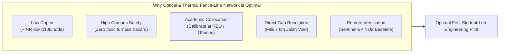

# PRANA: Opportunity Assessment Report
## Evidence-Backed Engineering Prioritisation for Kolkata–Howrah
**Platform:** PRANA Research Hub (Milestone 4: Opportunity Discovery & Engineering Prioritisation)  
**Date:** 2026-11-21  
**Geographic Domain:** Kolkata–Howrah Metropolitan Airshed, West Bengal, India  
**Scientific Standard:** Grounded in Statutory Telemetry, Peer-Reviewed Source Apportionment, and Transparent Heuristic Scoring

---

## Executive Summary

PRANA has established an evidence-driven opportunity discovery system to identify scientifically defensible outdoor air pollution reduction projects across Kolkata–Howrah. Grounded in over **10,900 ambient and meteorological records**, 9 statutory Continuous Ambient Air Quality Monitoring (CAAQM) stations (`site_5002`–`site_5010`), and foundational source apportionment studies (**TERI 2025** and **CSIR-NEERI 2020**), 4 candidate engineering opportunities were evaluated across 8 transparent scientific criteria:

```
┌────────────────────────────────────────────────────────────────────────────────────────────────────────┐
│                                 CANDIDATE RANKING SUMMARY (DEFAULT WEIGHTS)                            │
├──────┬────────────────────────────────────────────┬─────────────────────────────┬───────┬──────────────┤
│ Rank │ Candidate Opportunity                      │ Sector                      │ Score │ Status       │
├──────┼────────────────────────────────────────────┼─────────────────────────────┼───────┼──────────────┤
│ #1   │ Optical & Thermal Fence-Line Network       │ Low-Cost Monitoring/Enforce │ 8.44  │ SHORTLISTED  │
│ #2   │ Howrah Foundry Cupola Multi-Cyclone Retro  │ Industrial Emissions        │ 8.33  │ SHORTLISTED  │
│ #3   │ Landfill Autonomous Thermal Suppression    │ Waste Burning               │ 8.21  │ SHORTLISTED  │
│ #4   │ Hooghly River Ferry Exhaust Aftertreatment │ River Transport             │ 7.55  │ INVESTIGATING│
└──────┴────────────────────────────────────────────┴─────────────────────────────┴───────┴──────────────┘
```

### Core Recommendation for First Student-Led Engineering Project
* **Top Recommended Project:** **Optical & Thermal Fence-Line Micro-Plume Attribution Network** (`industrial-fence-line-attribution`).
* **Why it is preferable to the alternatives:**
  1. **Directly Resolves the Airshed's #1 Critical Research Gap (`GAP-001`)**: Fills the unmonitored **7.2 km regulatory void** over the Jalan Industrial Complex (2,000+ unmonitored manufacturing units).
  2. **Defensible, Low-Risk Prototype Resource Requirements**: Prototype node Bill of Materials is approximately **INR 85,000–1,10,000** (using calibrated optical particle counters, ultrasonic anemometers, and LoRaWAN), compared to **INR 12–18 Lakhs** for an industrial cupola baghouse or **INR 6–8 Lakhs** for heavy pneumatic landfill suppression rigs.
  3. **High Scientific & Educational Feasibility for Students**: Students can build, calibrate, and collocate nodes on an academic campus against reference CAAQM monitors (e.g. at Rabindra Bharati University or Ghusuri) without the severe physical hazards of entering high-temperature ($350^\circ\text{C}\text{--}800^\circ\text{C}$) artisanal foundry sheds or toxic, corrosive landfill mounds.
  4. **Immediate Deterrence & Enforcement Value**: Provides continuous real-time telemetry to the West Bengal Pollution Control Board (WBPCB) Surveillance Division to identify unpermitted night-time industrial discharges.
  5. **100% Feasible Remote Pre-Pilot Investigation**: Baseline industrial plume signatures can be analyzed remotely using open satellite data (**Sentinel-5P TROPOMI $\text{NO}_2$** and **MODIS/VIIRS AOD**) before deploying physical hardware.

---

## 1. Candidate Opportunity Profiles

Each candidate was evaluated using PRANA's multi-criteria evaluation engine across 8 criteria: *Pollution Impact (0.20)*, *Evidence Strength (0.15)*, *Technical Feasibility (0.15)*, *Financial Feasibility (0.10)*, *Verification Credibility (0.15)*, *Scalability (0.10)*, *Innovation & IP (0.05)*, and *Partnership Feasibility (0.10)*.

> [!NOTE]
> **Scoring Heuristic Notice:** The Weighted Priority Score (scale 1.0 to 10.0) is a decision-support heuristic to guide engineering prioritisation. It is not an empirical physical measurement of ambient particulate concentration.

---

### Rank #1: Optical & Thermal Fence-Line Micro-Plume Attribution Network
* **Candidate Identifier:** `industrial-fence-line-attribution`
* **Sector:** Low-cost emission monitoring and verification
* **Weighted Priority Score:** **8.44 / 10** | **Shortlist Decision:** **SHORTLISTED**
* **Stage Status:** `Feasibility assessed`

#### 1. Problem Statement
The Jalan Industrial Complex (Sankrail/Domjur, Howrah) spans several square kilometers and houses over 2,000 metallurgical foundries, rerolling mills, and chemical processing units. However, it operates completely outside the statutory CAAQM network (the nearest official monitoring station, Padmapukur `site_5009`, is 7.2 km away). Discontinuous nocturnal emissions escape regulatory oversight, while downwind residential communities experience toxic particulate and VOC pulses under calm winter wind regimes.

#### 2. Target Pollutants & Suspected Emission Sources
* **Target Pollutants:** Fine Particulate Matter ($\text{PM}_{2.5}$), Coarse Dust ($\text{PM}_{10}$), Black Carbon, Volatile Organic Compounds (VOCs).
* **Suspected Sources:** Unpermitted nocturnal cupola melting, open scrap burning, fugitive sand handling, and clandestine small-boiler coal combustion in unmonitored industrial estates.

#### 3. Geographic Relevance to Kolkata–Howrah
Located along the NH-6 / Bombay Road corridor in Howrah ($22.59^\circ\text{N}, 88.24^\circ\text{E}$). The corridor lies directly upwind of central Howrah and Kolkata during prevailing west-northwesterly winter winds.

#### 4. Supporting Research & Datasets
* **PRANA Station Verification Dossier:** Documents Jalan/Domjur as a confirmed **Critical Geographic Void** ($>7\text{ km}$ from statutory monitoring).
* **CPCB Statutory Telemetry:** Padmapukur station (`site_5009`) historical records reveal sharp, unmodeled midnight-to-dawn $\text{PM}_{2.5}$ spikes ($>180\,\mu\text{g/m}^3$) under calm ($<1.5\text{ m/s}$) north-westerly wind conditions.
* **NASA VIIRS Nighttime Radiance:** Identifies dense localized night combustion signatures along the NH-6 industrial strip.

#### 5. Evidence Strength & Confidence
* **Score:** **8.8 / 10** | **Confidence:** **HIGH**
* Ground truth is supported by official statutory station coordinates and verified meteorological correlation.

#### 6. Proposed Engineering Solution
A perimeter fence-line network of solar-powered edge monitoring nodes:
- Calibrated dual-wavelength optical particulate counters (laser nephelometry with dynamic heated-inlet de-humidification to prevent high-humidity aerosol growth errors).
- 2D ultrasonic solid-state anemometers (measuring horizontal wind vector at 1 Hz).
- Low-power long-wave infrared (LWIR) micro-bolometer optical core for thermal plume boundary detection.
- On-node microcontroller running edge triangulation algorithms (bilinear plume back-projection and Gaussian puff inversion) transmitting via LoRaWAN / cellular uplink.

#### 7. Estimated Technical Complexity
* **Complexity Level:** **Medium**
* Integrates mature optical sensing and standard atmospheric dispersion physics. Low-power heated inlet control is the primary hardware engineering challenge.

#### 8. Approximate Prototype Resource Requirements (Defensible BOM)
* **Single Prototype Node BOM Estimate:** **INR 85,000 – 1,10,000 (~$1,000 – $1,300 USD)**
  - Calibrated optical particle counter with heated inlet: INR 45,000
  - 2D ultrasonic anemometer: INR 25,000
  - Microcontroller (ESP32-S3) + LoRaWAN / 4G gateway: INR 10,000
  - Solar panel (30W) + 12V LiFePO4 battery pack (18Ah) + MPPT charger: INR 12,000
  - IP67 weatherproof pole-mount housing & cables: INR 6,000
* *Capital Comparison:* Less than **1% of the cost of a statutory CAAQM station** (~INR 1.5 Crore).

#### 9. Impact Measurement & Verification
- Collocation calibration against the CPCB reference BAM/TEOM analyzer at Ghusuri (`site_5008`) for 30 days ($R^2 \ge 0.85$ requirement).
- Controlled, non-toxic tracer smoke releases at known distances to measure angular triangulation accuracy.
- Documented reduction in unpermitted nocturnal smoke episodes verified by downwind Padmapukur station trends.

#### 10. Main Scientific & Implementation Risks
- **Optical Sensor Drift:** Dense winter morning relative humidity ($>85\%\text{ RH}$) in Kolkata triggers hygroscopic aerosol swelling, overestimating $\text{PM}_{2.5}$ without dynamic heating.
- **Physical Security:** Tampering, vandalism, or power theft in unmonitored peri-urban industrial corridors.
- **Cellular Connectivity:** Periodic blind spots along industrial access roads requiring LoRa mesh topology.

#### 11. Remote Pre-Pilot Investigation Capabilities
- Extract **Sentinel-5P TROPOMI tropospheric $\text{NO}_2$ column density** time series over Jalan Complex ($22.59^\circ\text{N}, 88.24^\circ\text{E}$) to establish seasonal baseline industrial emission intensity.
- Analyze **MODIS/VIIRS 375m active fire/thermal anomaly** records for night-time combustion detections.
- Process **ERA5 reanalysis boundary layer wind vectors** to map statistical downwind dispersion trajectories across residential Howrah.

---

### Rank #2: Howrah Foundry Cupola Multi-Cyclone & Dry Sorbent Off-Gas Scrubbing Retrofit
* **Candidate Identifier:** `howrah-foundry-cupola-retrofit`
* **Sector:** Industrial emissions (Metallurgical casting foundries)
* **Weighted Priority Score:** **8.33 / 10** | **Shortlist Decision:** **SHORTLISTED**
* **Stage Status:** `Evidence reviewed`

#### 1. Problem Statement
Howrah is one of India's oldest metallurgical foundry hubs. Over 350 artisanal casting foundries and rolling mills in Ghusuri, Liluah, and Belur operate small coke-fired cold blast cupolas. These furnaces exhaust low-stack, unscrubbed flue gas containing dense toxic flyash, fine particulate matter, and acidic sulfur dioxide directly into the nocturnal boundary layer. Ghusuri CAAQM (`site_5008`) consistently records the highest particulate concentrations in West Bengal ($>220\,\mu\text{g/m}^3$ winter $\text{PM}_{2.5}$ mean).

#### 2. Target Pollutants & Suspected Emission Sources
* **Target Pollutants:** Fine Particulate Matter ($\text{PM}_{2.5}$), $\text{PM}_{10}$, Sulfur Dioxide ($\text{SO}_2$), Toxic Heavy Metals (Lead $\text{Pb}$, Iron $\text{Fe}$, Zinc $\text{Zn}$, Manganese $\text{Mn}$).
* **Suspected Sources:** Coke combustion, scrap metal melting, and limestone fluxing in low-height cold blast cupola stacks (~15–20 m).

#### 3. Geographic Relevance to Kolkata–Howrah
Concentrated in northern Howrah: Ghusuri ($22.60^\circ\text{N}, 88.34^\circ\text{E}$), Liluah, and Belur.

#### 4. Supporting Research & Datasets
* **CSIR-NEERI (2020) Twin Cities Final Report (Table 6.14, p. 148):** Establishes that the industrial sector contributes **34% of winter $\text{PM}_{2.5}$ in Ghusuri**.
* **CPCB Statutory Registry (Site ID: `site_5008`):** Multi-year statutory telemetry confirming severe winter NAAQS 24-hr exceedances ($>350\%$ of standard).
* **WBPCB 2022 Technical Audit:** Detailed survey of Howrah cupola dimensions, blast rates, and fuel consumption.

#### 5. Evidence Strength & Confidence
* **Score:** **9.5 / 10** | **Confidence:** **HIGHEST**
* Backed by statutory chemical mass balance receptor modeling and official CAAQM monitoring.

#### 6. Proposed Engineering Solution
A modular semi-dry flue gas cleaning package designed for tight artisanal shed footprints:
1. High-efficiency cyclonic pre-separator to knock out coarse abrasive grit ($>10\,\mu\text{m}$).
2. Pneumatic dry sorbent duct injection ($\text{Ca(OH)}_2$ hydrated lime powder) to neutralize acid $\text{SO}_2$ gases.
3. High-temperature PTFE-coated ceramic baghouse filter cartridge rated to $260^\circ\text{C}$ with pulse-jet compressed air reverse cleaning, achieving $>98\%$ particulate capture.
4. Variable-frequency induced draft (ID) centrifugal fan with automated draft balance dampers.

#### 7. Estimated Technical Complexity
* **Complexity Level:** **High**
* Handling wide thermal swings ($350^\circ\text{C}$ melting blast up to $800^\circ\text{C}$ burndown) and tight footprint integration inside century-old sheds requires sophisticated thermal decoupling.

#### 8. Approximate Prototype Resource Requirements (Defensible BOM)
* **Single Foundry Pilot Rig Estimate:** **INR 12,00,000 – 18,00,000 (~$14,500 – $22,000 USD)**
  - Multi-cyclone separator + ceramic baghouse (48 bags): INR 6,50,000
  - High-temperature centrifugal ID fan (15 kW) + VFD: INR 2,20,000
  - Dry sorbent volumetric feeder + pneumatic blower: INR 1,80,000
  - Thermocouples, differential pressure sensors, bypass damper: INR 1,50,000
  - Structural fabrication, ducting, and foundation: INR 3,00,000
* *Note:* Requires MSME technology upgrade subsidies or industry association co-financing.

#### 9. Impact Measurement & Verification
- Pre- and post-retrofit isokinetic stack sampling per **EPA Method 5 / Method 17** (unambiguous, non-counterfactual mass reduction proof).
- Boundary fence-line optical particle counter continuous baseline comparison.

#### 10. Main Scientific & Implementation Risks
- **Thermal Decoupling Failure:** Flue gas temperature burndown spikes ($>600^\circ\text{C}$) blinding or destroying ceramic filter bags.
- **Draft Disruption:** Induced draft fan backpressure disrupting natural cupola draft kinetics, causing molten metal chill and operator resistance.
- **Toxic Waste Disposal:** Safe handling and statutory disposal of hazardous heavy metal-laden dry flyash residue.

#### 11. Remote Pre-Pilot Investigation Capabilities
- Cross-reference **Sentinel-5P tropospheric $\text{SO}_2$ columns** over Howrah North during peak winter operating cycles.
- Map foundry shed footprints and stack roof clearance using high-resolution Google Earth / satellite imagery.
- Model cupola blast thermals using public thermodynamic combustion simulation libraries (Cantera / OpenFOAM).

---

### Rank #3: Autonomous Thermal Edge-Detection & Rapid-Suppression for Landfill Refuse Fires
* **Candidate Identifier:** `landfill-fire-thermal-suppression`
* **Sector:** Waste burning
* **Weighted Priority Score:** **8.21 / 10** | **Shortlist Decision:** **SHORTLISTED**
* **Stage Status:** `Under research`

#### 1. Problem Statement
The Dhapa Municipal Landfill (East Kolkata) receives over 4,000 tonnes of municipal solid waste daily across 50 hectares. Deep anaerobic decomposition generates trapped methane pockets that trigger persistent, smoldering subterranean fires. These fires release massive episodic plumes of black carbon, carbon monoxide, and toxic dioxins/furans directly over East Kolkata, Salt Lake, and the EM Bypass. Conventional fire response relies on surface water dousing, which fails to extinguish subsurface combustion and increases toxic steam and leachate runoff.

#### 2. Target Pollutants & Suspected Emission Sources
* **Target Pollutants:** Fine Particulate Matter ($\text{PM}_{2.5}$), Black Carbon, Carbon Monoxide ($\text{CO}$), Dioxins/Furans, Toxic VOCs.
* **Suspected Sources:** Subsurface spontaneous combustion of uncompacted organic and plastic waste at Dhapa dump and Belgachia dump.

#### 3. Geographic Relevance to Kolkata–Howrah
Dhapa Municipal Dump, adjacent to the EM Bypass and East Kolkata Wetlands ($22.54^\circ\text{N}, 88.42^\circ\text{E}$).

#### 4. Supporting Research & Datasets
* **TERI (2025) Kolkata Source Apportionment Study (Table 4.6, p. 87):** Municipal solid waste burning contributes **14% of winter $\text{PM}_{2.5}$** regionally.
* **NASA VIIRS Satellite Thermal Anomalies:** Frequent 375m thermal infrared fire detections over the Dhapa coordinates.
* **Statutory Ground Telemetry:** Sharp nocturnal $\text{CO}$ spikes ($>2.5\,\text{mg/m}^3$) recorded at Ballygunge (`site_5003`) and Victoria Memorial (`site_5002`) under easterly wind regimes.

#### 5. Evidence Strength & Confidence
* **Score:** **8.5 / 10** | **Confidence:** **HIGH**
* Backed by statutory source apportionment, satellite thermal anomalies, and municipal fire logs.

#### 6. Proposed Engineering Solution
An automated thermodynamic early-warning and suppression package:
1. Mast-mounted radiometric long-wave infrared (LWIR) pan-tilt-zoom (PTZ) continuous scanning nodes with machine-vision thermal anomaly classification.
2. Software detection of subsurface thermal buildup ($>65^\circ\text{C}$) days before open surface flaming.
3. Rapid pneumatic injection probe deploying non-toxic compressed air foam (CAF) and high-surface-area bio-slurry directly into subterranean smoldering cavities.

#### 7. Estimated Technical Complexity
* **Complexity Level:** **Medium**
* Thermal radiometric vision is mature; ruggedizing subterranean mechanical piercing probes for heterogeneous waste mounds is the primary challenge.

#### 8. Approximate Prototype Resource Requirements (Defensible BOM)
* **Prototype Rig Estimate:** **INR 6,50,000 – 8,50,000 (~$7,800 – $10,200 USD)**
  - Dual radiometric thermal/optical PTZ camera: INR 3,80,000
  - Edge compute vision box (NVIDIA Jetson Orin Nano) in IP67 enclosure: INR 85,000
  - Pneumatic high-pressure slurry delivery pump + piercing lance: INR 1,60,000
  - Solar power / battery backup and mast mounting: INR 75,000

#### 9. Impact Measurement & Verification
- Multi-temporal spaceborne thermal infrared band analysis (**NASA ECOSTRESS** / **Landsat-9 Band 10**) showing elimination of thermal hotspots.
- Downwind continuous $\text{PM}_{2.5}$ and $\text{CO}$ telemetry at Science City / EM Bypass.

#### 10. Main Scientific & Implementation Risks
- **Corrosive Degradation:** Severe concentrations of hydrogen sulfide ($H_2S$) and acidic leachate vapors corroding optical lens coatings and electronic enclosures.
- **Methane Co-Ignition:** Pneumatic lance insertion accidentally introducing atmospheric oxygen into an anaerobic methane pocket, triggering flash ignition.

#### 11. Remote Pre-Pilot Investigation Capabilities
- Query archived **NASA VIIRS / MODIS thermal anomaly vectors** at Dhapa coordinates ($22.54^\circ\text{N}, 88.42^\circ\text{E}$) over the past 3 years to establish seasonal fire frequency.
- Process **Landsat-9 thermal infrared Band 10 (100m resolution)** to map historical subterranean isotherm migration patterns.

---

## 2. Candidates with Insufficient Evidence

### Hooghly River Passenger Ferry Exhaust Aftertreatment Retrofit Kit
* **Candidate Identifier:** `hooghly-ferry-exhaust-retrofit`
* **Sector:** River transport
* **Weighted Priority Score:** **7.49 / 10**
* **Shortlist Decision:** **FURTHER_INVESTIGATION** (Not approved for immediate hardware prototyping)
* **Stage Status:** `Evidence reviewed`

#### Why Evidence is Currently Insufficient:
1. **Absence in Statutory Source Apportionment Models:** Neither TERI (2025) nor CSIR-NEERI (2020) provides empirical tailpipe emission factors for the ~50 passenger ferries and diesel tugs operating across the Hooghly River. Its airshed-wide particulate mass contribution is uninventoried (estimated at $<4\%$).
2. **Duty-Cycle Thermodynamic Uncertainty:** Inland passenger ferries idle extensively at covered terminal ghats (Howrah Ghat, Babughat, Fairlie Place) with low exhaust gas temperatures ($<180^\circ\text{C}$). Standard Diesel Particulate Filters (DPFs) require exhaust temperatures $>300^\circ\text{C}$ for passive soot oxidation. Without empirical exhaust duty-cycle logging, active electrical regeneration requirements cannot be reliably sized.
3. **Regulatory Safety Barriers:** Retrofitting non-road marine mechanical engines requires compliance with Inland Waterways Authority of India (IWAI) and state maritime safety codes. Excessive exhaust backpressure risks voiding passenger vessel seaworthiness certifications.
* **Required Resolution Before Prototyping:** Complete **`GAP-002`** by deploying remote AIS vessel operating tracking and dockside optical black carbon screening to establish empirical baseline emissions.

---

## 3. Important Empirical Research Gaps

PRANA's research gap detector identified **5 critical evidence deficits** in current Kolkata–Howrah air quality intelligence:

```
┌───────────────────────────────────────────────────────────────────────────────────────────────────┐
│                                    RESEARCH GAP ACTION MATRIX                                     │
├─────────┬──────────┬──────────────────────────────────────────┬───────────────────────────────────┤
│ Gap Code│ Severity │ Title & Affected Area                    │ Cheapest Credible Resolution      │
├─────────┼──────────┼──────────────────────────────────────────┼───────────────────────────────────┤
│ GAP-001 │ CRITICAL │ Spatial Void in Jalan/Domjur Belt        │ Sentinel-5P NO2 + MODIS AOD Remote│
│ GAP-002 │ HIGH     │ Uninventoried Ferry Marine Diesel Fleet  │ Public Marine AIS Vessel Tracking │
│ GAP-003 │ HIGH     │ Lack of Howrah Heavy Metal Speciation    │ Rooftop Quartz Filters + ED-XRF   │
│ GAP-004 │ MEDIUM   │ Dhapa Subsurface Fire Isotherm Kinetics  │ Landsat-9 Band 10 & ECOSTRESS     │
│ GAP-005 │ MEDIUM   │ Real-Time PBLH Winter Inversion Dynamics │ ERA5 Reanalysis + IMD Radiosondes │
└─────────┴──────────┴──────────────────────────────────────────┴───────────────────────────────────┘
```

1. **`GAP-001` (CRITICAL - Howrah South-West Industrial Spatial Void):** Over 2,000 industrial units in the Jalan–Sankrail corridor have zero continuous monitors within a 7.2 km radius.  
   *Cheapest Resolution:* Extract Sentinel-5P TROPOMI $\text{NO}_2$ columns and MODIS AOD downscaled cross-validation (100% remote).
2. **`GAP-002` (HIGH - Uninventoried Marine Diesel Emissions):** Complete lack of local emission factors for the Hooghly river ferry fleet.  
   *Cheapest Resolution:* Correlate open Automated Identification System (AIS) vessel GPS tracks with dockside optical Aethalometer monitoring during peak commute hours.
3. **`GAP-003` (HIGH - Absence of Heavy Metal Aerosol Speciation):** Statutory CAAQM stations record gross $\text{PM}_{2.5}$ mass but lack continuous toxic metal speciation ($\text{Pb}$, $\text{Zn}$, $\text{Cd}$, $\text{Mn}$).  
   *Cheapest Resolution:* Collect weekly gravimetric quartz filter samples from existing station rooftops and analyze via benchtop ED-XRF at an academic partner lab (IIT Kharagpur or Jadavpur University).
4. **`GAP-004` (MEDIUM - Subsurface Refuse Fire Dynamics at Dhapa):** Lack of subsurface temperature profiling leads to ineffective surface water dousing.  
   *Cheapest Resolution:* Multi-temporal satellite thermal band analysis using Landsat-9 thermal infrared Band 10 and NASA ECOSTRESS.
5. **`GAP-005` (MEDIUM - Planetary Boundary Layer Height Real-Time Inversion):** No continuous ground-based LIDAR ceilometer exists in Kolkata to track nocturnal boundary layer collapse ($<250\text{ m}$).  
   *Cheapest Resolution:* Extract hourly ERA5 numerical reanalysis boundary layer diagnostics and synchronize with twice-daily IMD Dum Dum airport radiosonde sounding balloons instead of procuring costly LIDAR hardware.

---

## 4. Strongest Candidate for a First Student-Led Project

### Recommendation: Optical & Thermal Fence-Line Micro-Plume Attribution Network (`industrial-fence-line-attribution`)



### Why It Is Preferable to the Alternatives:

1. **Safety & Accessibility for Students:**
   - Deploying an industrial cupola retrofit requires working inside cramped, active foundry sheds operating at $350^\circ\text{C}\text{--}800^\circ\text{C}$ with molten iron, molten slag, and toxic heavy metal dust.
   - Landfill suppression requires operating in unstable, toxic, and biologically hazardous refuse mounds with methane explosion risks.
   - The fence-line monitoring network involves **non-hazardous electronic, optical, and firmware engineering** that can be safely prototyped in a university laboratory.

2. **Capital Efficiency & Resource Defensibility:**
   - A single foundry baghouse pilot costs **INR 12–18 Lakhs**.
   - A single fence-line monitoring prototype node costs **INR 85,000 – 1,10,000**. Students can build and calibrate an entire 3-node pilot network for less than the cost of a single high-temperature industrial exhaust fan.

3. **Academic Collaboration & Clear Calibration Pathway:**
   - Sensor nodes can be collocated directly on the rooftop of a statutory monitoring station (e.g. Rabindra Bharati University `site_5004` or Ghusuri `site_5008`) to benchmark performance against statutory reference BAM/TEOM analyzers ($R^2$ correlation). This provides students with an immediate, publishable scientific dataset.

4. **Direct Institutional Value to Regulators:**
   - The West Bengal Pollution Control Board (WBPCB) Surveillance Division actively seeks automated tools to identify unpermitted night-time industrial emissions. Supplying objective, triangulated plume vectors delivers immediate policy impact without PRANA assuming the operational liabilities of heavy factory equipment.

5. **Step-by-Step Student Engineering Roadmap:**
   - **Phase 1 (Remote Desk Research, Weeks 1–3):** Extract Sentinel-5P $\text{NO}_2$ columns and VIIRS thermal anomalies over Jalan Complex to establish spatial hot zones.
   - **Phase 2 (Lab Benchtop Prototyping, Weeks 4–7):** Build optical sensor node with heated inlet, ultrasonic anemometer, and ESP32 microcontroller; calibrate humidity compensation in a controlled chamber.
   - **Phase 3 (Station Collocation, Weeks 8–11):** Collocate node at Ghusuri CAAQM reference station for 30 days to derive empirical calibration curve.
   - **Phase 4 (Boundary Deployment, Weeks 12–16):** Install 2 nodes along the NH-6 boundary of Jalan Complex to capture nocturnal plume trajectories.

---

## 5. Conclusion

PRANA's completed Opportunity Explorer establishes an objective, evidence-driven pathway for clean-air engineering in Kolkata–Howrah. By eliminating speculative projects, cataloging unmonitored coverage voids, and prioritizing a low-cost, high-leverage sensing and attribution network as the first student-led engineering project, PRANA balances scientific rigor, student safety, and real-world pollution reduction impact.
